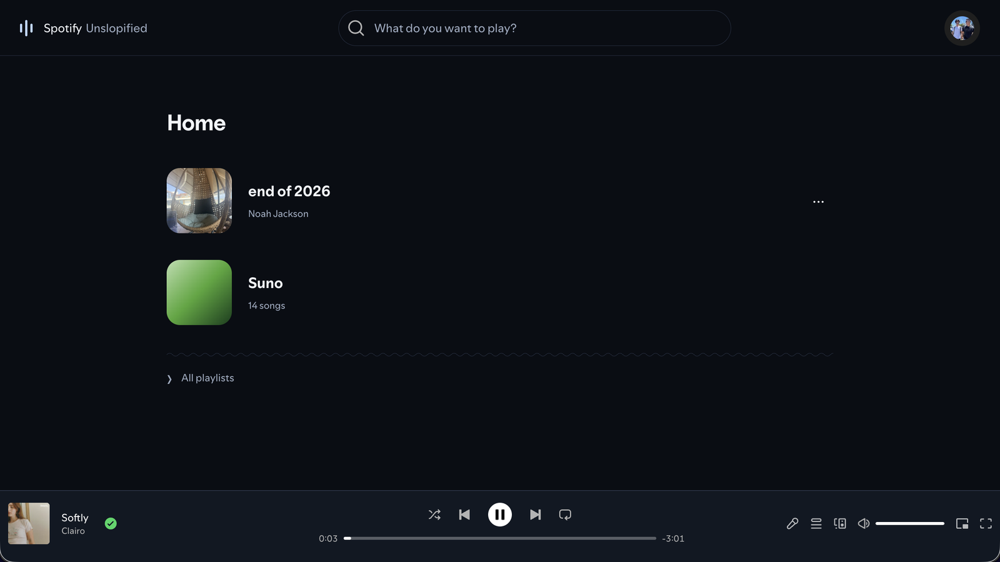

# Spotify Unslopified

**Spotify without the slop. A quieter web player for Chrome.**

Your playlists up front. Search when you want it. No recommendations feed to scroll past.

- Choose exactly which playlists appear on Home.
- Keep Spotify’s songs, search and playback controls.
- Import your own music, with covers, a queue and timed lyrics.
- Share imported playlists with the [iPhone app](https://github.com/noah-jacksonn/spotify-unslopified-ios) through iCloud.

## Get it running

1. **Download** this repo (Code → Download ZIP) and unzip it.
2. Open `chrome://extensions`, enable **Developer mode**, then **Load unpacked** → select the **extension** folder.
3. Open [Spotify](https://open.spotify.com) and sign in as usual.

No build, API key or Spotify developer account needed. Choose **Show on Home** on a playlist to pin it. The extension popup’s **Unslopified mode** switch restores regular Spotify.

After updating the extension, reload it in `chrome://extensions`, then reload Spotify.

## Imported playlists

Open **All playlists → Imported**, or **Library** in the extension popup. Choose a dedicated folder, such as **Unslopified Music**. Each subfolder becomes a playlist; import audio in the app or drop files into a playlist folder in Finder.

For iPhone sharing, put that parent folder in **iCloud Drive** and select it in both apps using the same iCloud account. Covers, song details and lyrics sync with the files after iCloud delivers changes. **Keep offline** saves a playlist in Chrome. Disconnecting leaves your original files untouched.

For example, download music you made with **Suno AI** and import it into a Suno playlist. Add each song’s Suno link in Song details and keep a signed-in Suno tab open to fetch missing timed lyrics automatically.

## A few details

Imported playlists are separate from Spotify’s catalog playlists. Playback format support varies between iPhone and Chrome. Home choices stay in this Chrome profile.

No backend or analytics. Spotify credentials aren’t read; Suno authentication stays in its own tab. If Spotify changes its interface, turn off Unslopified mode until an update is available.

[Report a bug or suggest something](https://github.com/noah-jacksonn/spotify-unslopified-web/issues) · [Development](docs/DEVELOPMENT.md)

Independent project; not affiliated with Spotify or Suno.
